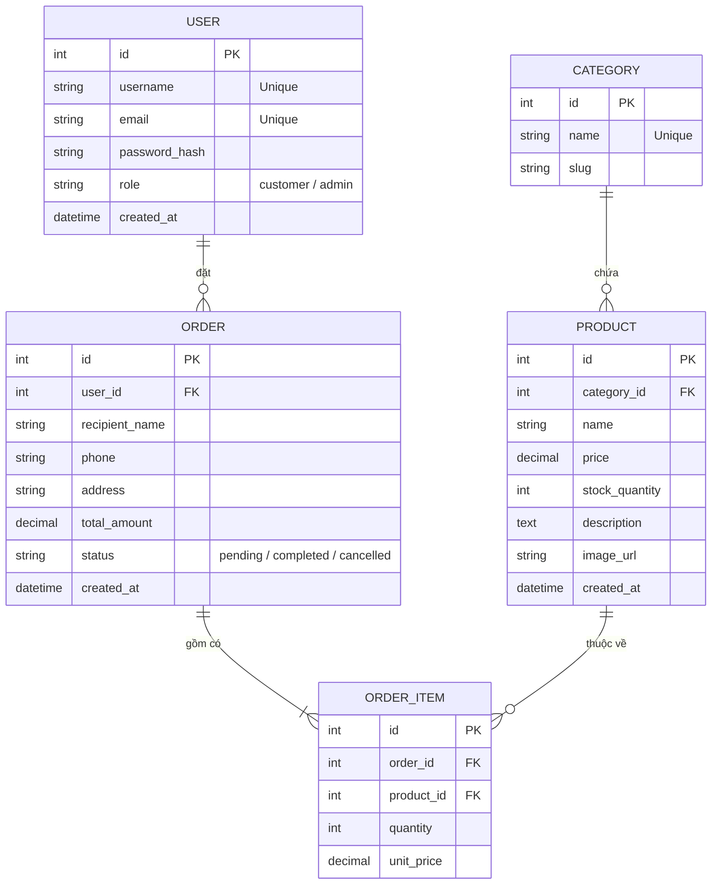

# 📋 TÀI LIỆU KẾ HOẠCH & ĐẶC TẢ TRIỂN KHAI DỰ ÁN
## WEBSITE BÁN HÀNG ĐIỆN TỬ (FLASK E-COMMERCE)

> **Nhóm thực hiện:** 03 thành viên  
> **Ngôn ngữ & Framework:** Python 3.x, Flask, Flask-SQLAlchemy, Flask-Login, Jinja2, Bootstrap 5, Chart.js  
> **Kiến trúc ứng dụng:** Application Factory Pattern + Flask Blueprints  
> **Cơ sở dữ liệu:** SQLite (Giai đoạn Dev) / PostgreSQL hoặc MySQL (Triển khai thực tế)

---

## MỤC LỤC
1. [Tổng Quan Kiến Trúc & Cấu Trúc Thư Mục](#1-tổng-quan-kiến-trúc--cấu-trúc-thư-mục)
2. [Phân Chia Trách Nhiệm Chi Tiết (Task Matrix)](#2-phân-chia-trách-nhiệm-chi-tiết-task-matrix)
3. [Thiết Kế Cơ Sở Dữ Liệu (Database Schema)](#3-thiết-kế-cơ-sở-dữ-liệu-database-schema)
4. [Hợp Đồng Giao Tiếp Giữa Các Module (Interface Contract)](#4-hợp-đồng-giao-tiếp-giữa-các-module-interface-contract)
5. [Quy Chuẩn Làm Việc Với Git & Nhánh (Workflow)](#5-quy-chuẩn-làm-việc-với-git--nhánh-workflow)
6. [Hướng Dẫn Cài Đặt & Chạy Thử Dự Án (Quickstart)](#6-hướng-dẫn-cài-đặt--chạy-thử-dự-án-quickstart)
7. [Lộ Trình Triển Khai (Milestones)](#7-lộ-trình-triển-khai-milestones)

---

## 1. TỔNG QUAN KIẾN TRÚC & CẤU TRÚC THƯ MỤC

Dự án áp dụng mô hình **Application Factory + Blueprints** để tách biệt mã nguồn theo chức năng, giúp các thành viên làm việc độc lập trên từng thư mục mà không gây xung đột code.

```text
my_flask_app/
│
├── app/
│   ├── __init__.py               # Khởi tạo App Factory (create_app), nạp config, db & blueprints
│   ├── extensions.py             # Nơi khai báo instance: db, login_manager, migrate
│   ├── models.py                 # Toàn bộ Database Models chung (User, Product, Order, ...)
│   │
│   ├── auth/                     # 👤 [PHỤ TRÁCH: DẦN]
│   │   ├── __init__.py           # Khai báo Blueprint 'auth'
│   │   ├── routes.py             # Xử lý /login, /register, /logout
│   │   └── forms.py              # Xử lý validate form (Flask-WTF hoặc thuần)
│   │
│   ├── main/                     # 🏠 [PHỤ TRÁCH: ÁNH & DẦN]
│   │   ├── __init__.py           # Khai báo Blueprint 'main'
│   │   └── routes.py             # Trang chủ (/), danh mục, chi tiết sản phẩm (/product/<id>)
│   │
│   ├── cart/                     # 🛒 [PHỤ TRÁCH: ÁNH]
│   │   ├── __init__.py           # Khai báo Blueprint 'cart'
│   │   ├── routes.py             # /cart, /cart/add, /cart/update, /checkout
│   │   └── cart_service.py       # Thuật toán tính tiền, quản lý giỏ hàng trong session
│   │
│   ├── admin/                    # 📊 [PHỤ TRÁCH: ÁNH & BẢO]
│   │   ├── __init__.py           # Khai báo Blueprint 'admin'
│   │   ├── routes.py             # [Ánh] CRUD Sản phẩm, Quản lý trạng thái Đơn hàng
│   │   └── stats_routes.py       # [Bảo] API Thống kê, Query doanh thu & báo cáo
│   │
│   ├── static/                   # 🎨 [GIAO DIỆN CHUNG: DẦN QUẢN LÝ CHÍNH]
│   │   ├── css/
│   │   │   └── style.css         # CSS tùy biến giao diện
│   │   ├── js/
│   │   │   ├── main.js           # [Dần] Tương tác giao diện (dropdown, modal, toggle)
│   │   │   └── charts.js         # [Bảo] Script gọi API và render Chart.js
│   │   └── images/               # Banner, logo, ảnh placeholder
│   │
│   └── templates/                # 🖼️ [HTML JINJA2: DẦN DỰNG KHUNG CHÍNH]
│       ├── base.html             # Khung chung (Navbar, Footer, Flash Message)
│       ├── index.html            # Trang chủ hiển thị danh sách sản phẩm
│       ├── product_detail.html   # Chi tiết sản phẩm
│       ├── cart.html             # Giao diện giỏ hàng
│       ├── checkout.html         # Form điền địa chỉ giao hàng & thanh toán
│       ├── auth/
│       │   ├── login.html        # Trang đăng nhập
│       │   └── register.html     # Trang đăng ký
│       └── admin/
│           ├── base_admin.html   # Khung sidebar/navbar của trang quản trị
│           ├── dashboard.html    # [Bảo] Chứa các thẻ <canvas> hiển thị biểu đồ
│           ├── products_manage.html # [Ánh] Bảng thêm/sửa/xóa sản phẩm
│           └── orders_manage.html   # [Ánh] Bảng xem và duyệt đơn hàng
│
├── config.py                     # Cấu hình Secret Key, URI Database, Upload folder
├── run.py                        # Điểm khởi động ứng dụng (python run.py)
├── requirements.txt              # Danh sách thư viện Python
├── .env.example                  # Mẫu cấu hình môi trường
└── .gitignore                    # Loại trừ venv, cache, file db tạm
```

---

## 2. PHÂN CHIA TRÁCH NHIỆM CHI TIẾT (TASK MATRIX)

| Thành viên | Phụ trách chính | Nhiệm vụ cụ thể | Đầu ra bàn giao (Deliverables) |
| :--- | :--- | :--- | :--- |
| **Ánh** | **Backend & Giỏ hàng (Cart, Core, Admin)** | 1. Khởi tạo cấu trúc dự án, file cấu hình, `extensions.py`, `models.py`.<br>2. Xây dựng logic Giỏ hàng (`session['cart']`) & Thanh toán (Tạo đơn, trừ tồn kho).<br>3. Viết backend trang Admin: Thêm/Sửa/Xóa sản phẩm, Cập nhật trạng thái đơn hàng.<br>4. Tạo dữ liệu mẫu (Seed Data) để cả nhóm cùng test. | - Chạy được server gốc (`run.py`).<br>- Chức năng giỏ hàng & thanh toán hoạt động mượt mà.<br>- Trang quản lý sản phẩm & đơn hàng cho admin. |
| **Dần** | **Authentication & Frontend UI** | 1. Hoàn thiện giao diện toàn bộ trang theo chuẩn Responsive (Bootstrap 5).<br>2. Viết logic Đăng ký, Đăng nhập, Đăng xuất sử dụng `Flask-Login` và mật khẩu mã hóa (`werkzeug.security`).<br>3. Xử lý Flash Message thông báo thành công/thất bại trên `base.html`.<br>4. Validate form nhập liệu (Email hợp lệ, độ dài mật khẩu). | - Template Jinja2 chuẩn, đẹp, khớp id/name input.<br>- Đăng nhập / Đăng ký hoạt động chuẩn xác, lưu session người dùng. |
| **Bảo** | **Thống kê (Analytics) & Biểu đồ (Charts)** | 1. Viết các câu query truy vấn dữ liệu từ bảng `Order`, `OrderItem`, `Product`:<br>   - Tổng doanh thu theo ngày/tháng/năm.<br>   - Số lượng đơn thành công / chờ xử lý / hủy.<br>   - Top 5 sản phẩm bán chạy nhất.<br>2. Viết API Endpoint trả về JSON (ví dụ `/admin/api/stats/revenue`).<br>3. Tích hợp thư viện **Chart.js**, viết `charts.js` vẽ biểu đồ lên `dashboard.html`. | - Dashboard Admin hiển thị trực quan các thẻ KPI và biểu đồ cột/tròn hoạt động tự động. |

---

## 3. THIẾT KẾ CƠ SỞ DỮ LIỆU (DATABASE SCHEMA)



---

## 4. HỢP ĐỒNG GIAO TIẾP GIỮA CÁC MODULE (INTERFACE CONTRACT)

Để các thành viên không phải chờ đợi nhau, nhóm thống nhất các quy ước sau:

### 4.1. Quy ước Form HTML & Template (Dần <-> Ánh & Bảo)
* **Form Đăng nhập (`login.html`)**:
  * Form method: `POST`, action: `{{ url_for('auth.login') }}`
  * Input name: `name="email"`, `name="password"`
* **Form Đăng ký (`register.html`)**:
  * Form method: `POST`, action: `{{ url_for('auth.register') }}`
  * Input name: `name="username"`, `name="email"`, `name="password"`, `name="confirm_password"`
* **Nút thêm vào giỏ hàng (`index.html` hoặc `product_detail.html`)**:
  * Form method: `POST`, action: `{{ url_for('cart.add_to_cart', product_id=product.id) }}`
  * Input số lượng (nếu có): `name="quantity"` (mặc định 1)
* **Hiển thị Flash Message trong `base.html`**:
  ```jinja2
  
    
      <div class="container mt-3">
        
          <div class="alert alert-{{ category if category != 'message' else 'info' }} alert-dismissible fade show" role="alert">
            {{ message }}
            <button type="button" class="btn-close" data-bs-dismiss="alert"></button>
          </div>
        
      </div>
    
  
  ```

### 4.2. Quy ước API Thống Kê Dữ Liệu (Bảo -> Dashboard)
Bảo tạo file `app/admin/stats_routes.py` cung cấp các API JSON sau để `charts.js` gọi:

1. **API Doanh thu theo tháng:**
   * **Endpoint:** `GET /admin/api/stats/monthly-revenue`
   * **Output JSON:**
     ```json
     {
       "labels": ["Tháng 1", "Tháng 2", "Tháng 3", "Tháng 4", "Tháng 5", "Tháng 6"],
       "revenues": [15000000, 22000000, 18500000, 31000000, 25000000, 42000000]
     }
     ```

2. **API Tỷ lệ trạng thái đơn hàng:**
   * **Endpoint:** `GET /admin/api/stats/order-status`
   * **Output JSON:**
     ```json
     {
       "labels": ["Hoàn thành", "Chờ xử lý", "Đã hủy"],
       "counts": [65, 20, 15]
     }
     ```

3. **API Top 5 sản phẩm bán chạy:**
   * **Endpoint:** `GET /admin/api/stats/top-products`
   * **Output JSON:**
     ```json
     {
       "labels": ["iPhone 15", "MacBook Air M2", "Tai nghe Sony XM5", "Bàn phím cơ", "Chuột Logitech"],
       "quantities": [120, 85, 70, 64, 52]
     }
     ```

---

## 5. QUY CHUẨN LÀM VIỆC VỚI GIT & NHÁNH (WORKFLOW)

### 5.1. Cấu trúc nhánh
* `main`: Nhánh chạy chính thức, tuyệt đối **không commit trực tiếp** lên đây.
* `dev`: Nhánh tổng hợp code để test tính năng chung.
* **Nhánh cá nhân:** Mỗi bạn tạo nhánh riêng từ `dev`:
  * Dần: `feature/auth-frontend`
  * Ánh: `feature/cart-order-backend`
  * Bảo: `feature/admin-stats-charts`

### 5.2. Quy trình làm việc hàng ngày
1. Trước khi code, luôn kéo code mới nhất về:
   ```bash
   git checkout dev
   git pull origin dev
   git checkout feature/<tên-nhánh-của-bạn>
   git merge dev
   ```
2. Sau khi hoàn thành một phần việc, commit rõ ràng:
   ```bash
   git add .
   git commit -m "feat(auth): hoan thien form dang ky va validate mat khau"
   git push origin feature/<tên-nhánh-của-bạn>
   ```
3. Tạo **Pull Request (PR)** từ nhánh feature vào nhánh `dev` để các thành viên khác xem xét trước khi merge.

---

## 6. HƯỚNG DẪN CÀI ĐẶT & CHẠY THỬ DỰ ÁN (QUICKSTART)

### Bước 1: Clone dự án và tạo môi trường ảo
```bash
git clone <URL_REPOSITORY>
cd my_flask_app

# Tạo môi trường ảo
python3 -m venv venv

# Kích hoạt môi trường ảo:
# Trên macOS/Linux:
source venv/bin/activate
# Trên Windows:
venv\Scripts\activate
```

### Bước 2: Cài đặt thư viện
```bash
pip install -r requirements.txt
```

### Bước 3: Cấu hình file `.env`
Tạo file `.env` từ file mẫu `.env.example`:
```env
FLASK_APP=run.py
FLASK_DEBUG=1
SECRET_KEY=khoa-bi-mat-rat-an-toan-123456
DATABASE_URL=sqlite:///techshop.db
```

### Bước 4: Chạy ứng dụng
```bash
python run.py
```
Mở trình duyệt truy cập: `http://127.0.0.1:5000`

---

## 7. LỘ TRÌNH TRIỂN KHAI (MILESTONES)

* **Giai đoạn 1 (Ngày 1 - 3): Dựng khung & Tích hợp sơ bộ**
  * Ánh tạo project, thiết kế Models, cấu hình database và file seed mẫu.
  * Dần hoàn thiện toàn bộ file HTML Jinja2 (khung giao diện) và CSS.
  * Bảo tìm hiểu Chart.js và chuẩn bị các hàm query thống kê giả lập.
* **Giai đoạn 2 (Ngày 4 - 7): Hoàn thiện Logic cốt lõi**
  * Dần ráp logic đăng nhập/đăng ký với `Flask-Login`.
  * Ánh hoàn thiện logic giỏ hàng (thêm, sửa, xóa, thanh toán tạo đơn).
  * Ánh hoàn thiện trang CRUD sản phẩm admin.
* **Giai đoạn 3 (Ngày 8 - 10): Tích hợp Thống kê & Hoàn thiện Dashboard**
  * Bảo viết xong các API thống kê và nhúng biểu đồ Chart.js vào `dashboard.html`.
  * Ráp nối phân quyền: Chỉ tài khoản `role == 'admin'` mới vào được `/admin`.
* **Giai đoạn 4 (Ngày 11 - 12): Kiểm thử & Đóng gói**
  * Cả nhóm test toàn bộ luồng: Đăng ký -> Chọn hàng -> Giỏ hàng -> Đặt hàng -> Admin duyệt -> Biểu đồ nhảy số.
  * Fix lỗi hiển thị và chuẩn bị slide báo cáo.
